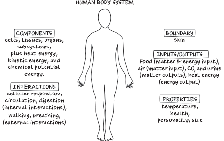
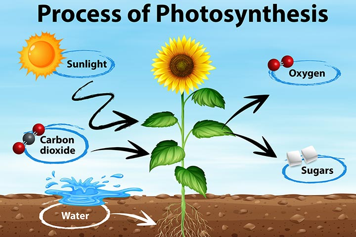
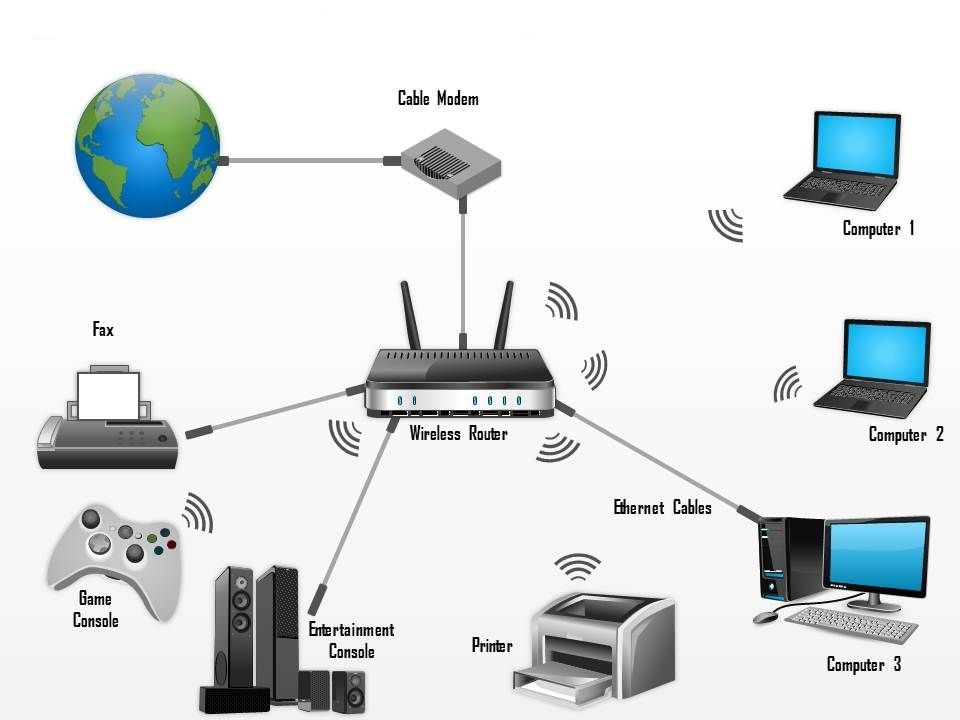
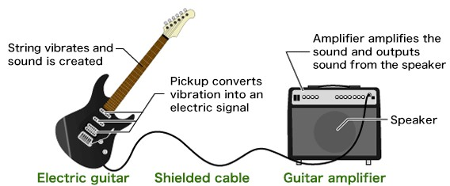
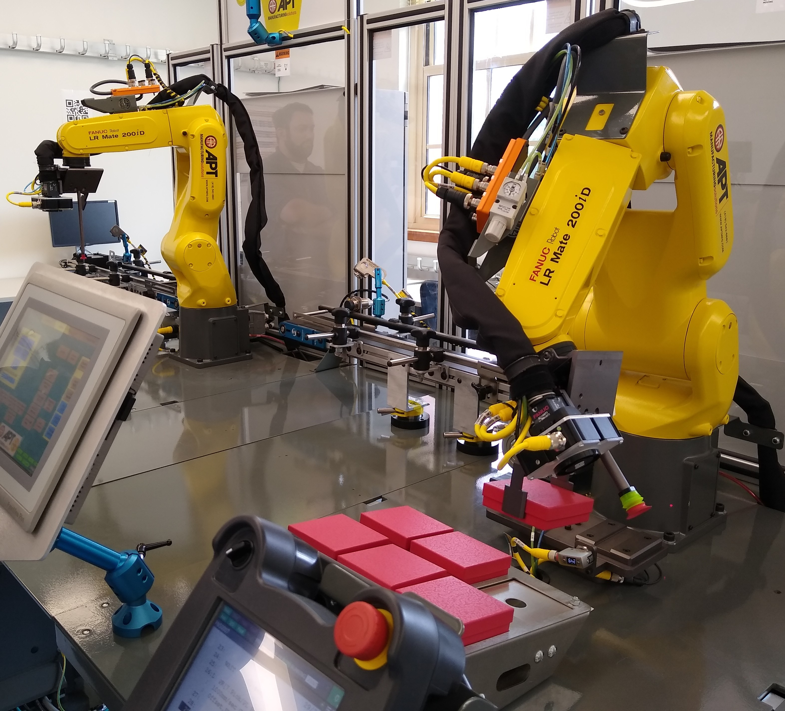

The goal of this course is to give students a general understanding of the fundamental principles of signals and systems. To start out, let's define what we mean by signals and systems.

A *signal* is...
- a detectable physical quantity, such as voltage or current, by which information may be transmitted
- a set of information or data

A *system* is...
- any interacting or interdependent group of items forming a unified whole
- any collection of objects for which some set of cause-and-effect relations exists
- an entity that processes a set of signals (inputs, excitations) to yield another set of signals (outputs, response)

## Examples

We now provide some examples of signals and systems.

- **Weather.** The weather is a complex system that relates signals such as temperature, pressure, density, and air velocity (wind) at each point in time. Meteorologists use models to predict weather based on current and past conditions, such as tracking the location of a hurricane. These models may be based on physics or constructed from historical data.
  
  

- **Human body.** The human body is a complex system that relates signals such as height, weight, temperature, blood flow, and electrical signals between neurons. Doctors use medications to influence (control) these signals in order to improve bodily function, such as fighting off a disease.
  
  

- **Chemical process.** The transformation of interacting chemicals forms a system, where the signals are the quantities and concentrations of the chemicals. For example, plants use photosynthesis to convert sunlight, carbon dioxide, and water into sugars for food while releasing oxygen as a byproduct.
  
  

- **Internet.** The internet is a complex interconnection of routers, modems, servers, and computers that enables signals to be transmitted between devices, either electrically through wires or wirelessly via electromagnetic waves. This can be viewed as a single (very large!) system, or as the connection of many small subsystems.

  

- **Audio system.** An audio system may be used to produce sound waves from a musical instrument or microphone. In an electric guitar, for example, the sound is created by the musician plucking a string to make it vibrate, which is then converted to an electric signal by the pickup, which is then amplified and converted to a sound wave by the speaker.

  

- **Robot.** A robot is an electromechanical system, meaning that it is composed of both electrical and mechanical components. Signals include the force, position, and velocity of each mechanical component, as well as voltages and currents in the circuits. The robot below is used in the course ECE 317: Industrial Robotics at Miami University.
  
  \cfig[width=0.8\textwidth,alt={Robot system}]{systems/robot-fanuc}

  

This is a very incomplete list of some signals and systems; the main point is that signals and systems are everywhere! As you go about your day, take a moment to observe some of the signals and systems that you interact with.

## Modeling

Now that we have seen some examples of signals and systems, let's discuss how we can describe them. We will start from the most natural and realistic description, and then abstract parts of the system to move towards a mathematical model that can be used to analyze the system.

\begin{itemize}
  \item \emph{Physical.} The most natural and realistic description of a system is its physical description. A description of the Mars rover, for instance, would include its dimensions, materials, and components.
  
  \cfig[width=0.6\textwidth,align=c,alt={Mars rover}]{systems/mars-rover}

  \item \emph{Diagrams.} Another way to describe a system is by schematic diagrams. Continuing with our example, we can describe the mechanical components of the Mars rover using a mechanical diagram:

  \cfig[alt={Spring-mass-damper system}]{mechanical-systems/spring-mass-damper/single}
  
  Here, $m$ is the mass of the robot, $k$ is its spring constant, $b$ is its damping coefficient, $y$ is its position, and $f$ is the force applied to it, such as through an electric motor. Note that the mass, spring constant, and damping coefficient are \textit{parameters} that typically do not change with time, while force and position are \textit{signals} that do depend on time.
  
  Likewise, the electrical components of the system can be described using a circuit diagram:
  
  \cfig[alt={RC circuit}]{circuits/rc}
  
  Here, $v_s$ is the source voltage applied to the circuit, $R$ is the resistance, $C$ is the capacitance, $i$ is the current, $v_r$ is the voltage across the resistor, and $v_c$ is the voltage across the capacitor. In this case, the resistance and capacitance are parameters of the circuit, while the voltages and current are signals.
  
  \item \emph{Equations.} From the schematic diagrams, we can write down differential equations that describe the relationship between the signals as a function of time. For instance, Newton's laws (force equals mass times acceleration) say that the force $f(t)$ and position $x(t)$ of the mass in our mechanical diagram are related by the second-order differential equation
  \[
    m\,\ddot y(t) + c\,\dot y(t) + k\,y(t) = f(t)
  \]
  Similarly, Kirchhoff's laws allow us to relate the source voltage $v_s(t)$ and the capacitor voltage $v_c(t)$ in the circuit diagram by the first-order differential equation
  \[
    RC\,\dot v_c(t) + v_c(t) = v_s(t)
  \]
  The dot notation means a derivative with respect to time, such as
  \[
    \dot x(t) = \ddt x(t) \qquad\text{and}\qquad
    \ddot x(t) = \frac{\d^2}{\dt^2} x(t)
  \]
  The derivation of such equations that describe a system is called \textit{modeling} and requires knowledge of the particular application domain.
\end{itemize}

%%%%%%%%%%%%%%%%%%%%%%%%%%%%%%%%%%%%%%%%%%%%%%%%%%%%%%%%%%%%%%%%%%%%%%%%%%
\section{Overview}
%%%%%%%%%%%%%%%%%%%%%%%%%%%%%%%%%%%%%%%%%%%%%%%%%%%%%%%%%%%%%%%%%%%%%%%%%%

As we have seen in each of the examples, a system describes the relationship between the various signals in a system. We typically think of the signals that we have control over as \textit{inputs} and those that we can measure as \textit{outputs}. The general depiction is as follows:

\cfig[alt={Overview of a system}]{block-diagrams/overview}

In this class, we\ldots

\begin{itemize}
  \item abstract signals and systems to study their fundamental properties
  \item focus on systems that are well-defined mathematically
\end{itemize}

In other words, we assume that a mathematical model of the system has already been constructed, and we study this model of the system. Keep in mind, however, that models do not always describe the system perfectly, and there is a trade-off between the complexity of the model and the difficulty in analyzing it!

For a given system, there are several types of problems that we may want solve:

\begin{itemize}
  \item \emph{Analysis.} The analysis problem is to quantify how the system reponds to various inputs. We may want to characterize qualitative properties of the system (such as whether or not it is stable) or quantitative properties (such as how much the system amplifies a sinusoidal input at a certain frequency).

  \item \emph{Design.} The design problem is to construct a system with some desired behavior. In robotics, for instance, engineers may design the electrical and mechanical components so that the robot is able to walk or run (as in a humanoid robot).
  
  \item \emph{Control.} In some cases, we do not have the ability to design the system (such as the weather or human body examples). Such systems can still be manipulated by choosing the inputs so that the system has some desired behavior. The main approach in control is to choose the input signals as a function of the outputs, which is called feedback.
  
  \item \emph{Identification.} For some systems, such as the weather example, it is too complicated to write down governing equations from first principles. In such cases, an alternative approach is to collect input/output data and use that to construct a mathematical model that approximately describes the behavior of the system. This is called system identification.
\end{itemize}

In this class, you will learn how to
\begin{itemize}
  \item classify signals and systems based on their properties
  \item convert between various representations of signals and systems
  \item compute and interpret the response of linear time-invariant systems
  \item interpret signals and systems in the frequency domain
  \item model a linear time-invariant system from input/output data
\end{itemize}

\medskip

\emph{Discussion:} What are some other examples of systems?
\begin{itemize}
  \item What are the input signals?
  \item What are the output signals?
  \item Why do you want to understand the behavior of the system?
\end{itemize}

%%%%%%%%%%%%%%%%%%%%%%%%%%%%%%%%%%%%%%%%%%%%%%%%%%%%%%%%%%%%%%%%%%%%%%%%%%
\section{Fundamental concepts}
%%%%%%%%%%%%%%%%%%%%%%%%%%%%%%%%%%%%%%%%%%%%%%%%%%%%%%%%%%%%%%%%%%%%%%%%%%

There are several fundamental concepts in signals and systems that we will be studying throughout the course.

\subsection{Signals can be viewed as functions of \textit{time} or \textit{frequency}}

While we typically think of signals as functions of time (such as the voltage in a circuit), it is often useful to interpret signals in terms of their \textit{frequencies}.

As an illustrative example, consider a musical signal such as an audio clip of a song. The signal consists of sound waves that apply pressure to your eardrums at each point in time. A \textit{tone} is an audio signal that consists of a single frequency. For instance, the tone $A_4$ is a single sinusoidal signal at a frequency of $440$ Hz (the tone often used to calibrate instruments). Songs consist of multiple tones happening at once to create music.

Consider a C major chord, which consists of the frequencies: 261.63 Hz ($C_4$), 329.23 ($E_4$), and 392.00 ($G_4$). As a function of time, this signal looks as follows:

\cfig[width=0.8\textwidth,alt={C major chord in time domain}]{frequency domain/C-chord-time}

From this time-domain representation of the signal, it is difficult to see that the signal is actually just three tones. If we instead represent this signal as a function of its frequencies (its frequency-domain representation), we get three ``spikes'' at the individual tones. There are small amounts of the other frequencies due to noise in the signal, but the amount of noise is small compared to the size of the signal.

\cfig[width=0.8\textwidth,alt={C major chord in frequency domain}]{frequency domain/C-chord-frequency}

Throughout the course, we will learn to interpret both signals and systems in the time and frequency domains. Some reasons for this are the following:
\begin{itemize}
  \item We may want to know what frequencies are in a signal. For instance, we are only able to hear frequencies between 20 Hz to 20,000 Hz, so any frequency content outside of this range is inperceptible (so we may want to remove it to save space when storing the signal on a computer).
  \item Many systems are much easier to understand in the frequency domain. In particular, systems that are \textit{linear} and \textit{time invariant} will play a large role in this course, and we will see that they are best understood in the frequency domain.
\end{itemize}

\subsection{Applications often involve continuous- and discrete-time signals and systems}

Continuous-time signals are defined at all points in time (like the voltage in a circuit or the force on an object), while discrete-time signals are defined only at discrete points in time. Many applications involve both continuous and discrete time due to the fact that signals are often \textit{continuous} (voltage, force, sound, image), while computers process and store \textit{discrete} information.

As an example, consider an audio signal that is processed (or stored) by a computer and then played back through speakers. The audio signal begins as a continuous-time signal of sound waves. A microphone converts the pressure waves to an electric signal (still in continuous time). The computer then uses an analog-to-digital converter to convert the electric signal to a series of bits that it can process and store. To play the signal back, those bits are passed through a digital-to-analog converter to produce an electric signal that is then put through the speaker which converts it to an audio signal.

\begin{center}
  audio \hfill$\to$\hfill microphone \hfill$\to$\hfill computer \hfill$\to$\hfill speaker \hfill$\to$\hfill sound
\end{center}

This basic idea of converting a continuous-time signal to discrete time, processing it using a computer, and then converting back to continuous time occurs in numerous applications. For instance, robots involve continuous-time signals such as forces, positions, velocities, voltages, and currents, while they are programmed using microcontrollers that operate on discrete-time signals.

We will only scratch the surface of the relationship between continuous and discrete time in this course. For those interested in learning more, this is one of the main topics in digital signal processing (DSP).

%%%%%%%%%%%%%%%%%%%%%%%%%%%%%%%%%%%%%%%%%%%%%%%%%%%%%%%%%%%%%%%%%%%%%%%%%%
\section{Example: RC circuit}
%%%%%%%%%%%%%%%%%%%%%%%%%%%%%%%%%%%%%%%%%%%%%%%%%%%%%%%%%%%%%%%%%%%%%%%%%%

To illustrate several more concepts that we will see throughout the course, consider a simple RC circuit.

\cfig[alt={RC circuit}]{circuits/rc}

\begin{itemize}
  \item the input signal $v_s(t)$ is the supplied voltage
  \item the output signal $v_c(t)$ is the capacitor voltage
  \item the initial condition $v_c(0)=a$ is the capacitor voltage at time $t=0$
  \item the time constant is $RC$
\end{itemize}

A circuit is a system that relates voltages and currents. The following table summarizes the relationship between voltage and current across a resistor, capacitor, and inductor.

\begin{center}
  \begin{tabular}{ccc}
    \textbf{component} & \textbf{voltage-current} & \textbf{impedence} \\[0.5em]
    \hline
    \includegraphics[align=c]{circuits/capacitor} & $\ds v(t) = \frac{1}{C} \int_{-\infty}^t i(\tau)\,\d\tau$ & $\dfrac{1}{Cs}$ \rule{0pt}{2.5em}\\[2em]
    \includegraphics[align=c]{circuits/resistor} & $v(t) = R\,i(t)$ & $R$ \\[2em]
    \includegraphics[align=c]{circuits/inductor} & $v(t) = L\,\dfrac{\d i(t)}{\dt}$ & $Ls$ \\
  \end{tabular}
\end{center}

We can analyze the circuit using these relationships along with Kirchhoff's voltage and current laws.

\begin{itemize}
    \item \emph{Kirchhoff's voltage law (KVL):} the sum of voltages around any closed loop is zero
    \item \emph{Kirchhoff's current law (KCL):} the sum of currents entering and exiting a node must be equal
\end{itemize}

From KVL, the supplied voltage is equal to the sum of the voltage across the resistor and capacitor:
\[
  v_s(t) = v_R(t) + v_c(t)
\]
From KCL, the same current flows through the resistor and capacitor. Using the relationship between the voltage and current across each component, we can write this in terms of voltages as
\[
  i(t) = \frac{1}{R}\,v_R(t) = C\,\dot v_c(t)
\]
Combining these equations, we find that the system is described by the differential equation
\[
  v_c(t) + RC\,\dot v_c(t) = v_s(t)
\]
This is a differential equation because it involves both signals (such as $v_s(t)$ and $v_c(t)$) and their derivatives ($\dot v_c(t)$). Given the source signal $v_s(t)$, the solution of the differential equation is the entire signal $v_c(t)$ as a function of time $t$.

From this representation, we can make several observations:

\begin{itemize}
  \item Continuous-time systems can be modeled using \textit{differential equations}. Discrete-time systems have a similar representation as \textit{difference equations}. This is only one way to represent systems, and we will see multiple other ways of describing a system.
  \item Dynamical systems have \textit{memory}. The solution depends on the initial condition $v_c(0)$, which is the capacitor voltage before the source voltage is applied. The response (or output) of a system depends on both the input to the system and what state it was in before the input was applied.
  \item Consider what happens to the circuit if the source voltage is zero. If the capacitor has an initial charge, then the charge will dissipate through the resistor when the circuit is connected until it has no charge left. This is called the \textit{zero-input} response of the system.
  
  Now consider what happens if the capacitor has no initial charge but we apply a constant source voltage. This constant voltage will charge the capacitor until it is fully charged. This is called the \textit{zero-state} response of the system because the system was initially ``at rest''.
  
  When there is both an initial state (the charge on the capacitor) and an input signal (the source voltage), the system response is the superposition of the zero-input and zero-state responses.
  
  \cfig[alt={RC circuit response}]{circuits/rc-response}
\end{itemize}
